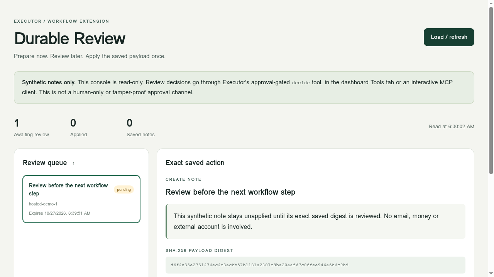
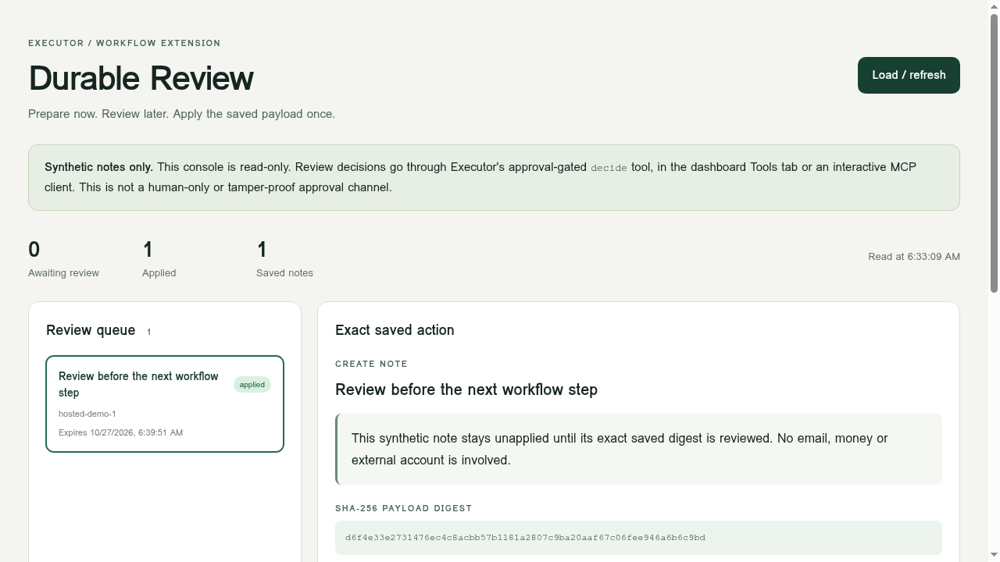

# Executor Durable Review

A product-tested, additive review-queue app for Executor. Prepare a synthetic note, leave its workflow waiting, review its immutable payload later, and apply once to local app SQL.

## The current product gap

Tested October 27, 2026 against the real Executor hosted dashboard and the official `executor@2.0.0-beta.30` release. A background workflow calling an ordinary `approval: always()` mutation moves to `errored`, reason `approval`, rather than holding a durable review request. Reproduced with the small app in `fixtures/evaluation/` on local framework `0.0.1-beta.110` and hosted framework `0.0.1-beta.115`.

Executor documents this boundary: its workflow context has no `elicit`, and background operations that require live input fail. This is a missing workflow capability, not a security vulnerability, surprise regression, or claim that all Executor approvals are broken. Scheduled tools already have a browser-review mode, which this does not replace.

Sources:
- https://executor.sh/docs
- https://executor.sh/docs/author-an-app
- https://executor.sh/docs/concepts/tools-and-approvals
- https://executor.sh/docs/run/cli
- https://github.com/UsefulSoftwareCo/executor/releases

## What this adds

- Immutable saved payload and SHA-256 digest. The decision must name that digest.
- Stable request keys: retries return the same request; a changed payload conflicts.
- Durable review state and a bounded workflow that sleeps while it is pending.
- A separate `decide` tool guarded by Executor's ordinary approval mechanism.
- Expiry, rejection and cancellation before apply.
- One transaction writes the synthetic note, receipt and audit event. Duplicate and concurrent applies return the receipt without creating another note.
- A read-only React console showing the exact payload, decision input, state and audit trail.

This is an app-level extension using existing Executor primitives. It does not add a native `waitForApproval` primitive or resume a failed upstream workflow. It models the review boundary explicitly and resumes its own workflow.

## Run and test

Node 22.18+ is required for the unit tests' native TypeScript stripping. Executor's runtime is packaged separately.

```sh
npm install --ignore-scripts --include=optional
npm test
npm run test:integration
```

The integration runner uses a fresh temporary Executor data directory, a separate port (default 4417, change with `EXECUTOR_TEST_PORT`), and no private account or external service. It starts and stops its own runtime. It deploys the app, exercises the real MCP endpoint and restarts the service midway. `EXECUTOR_BIN` can point to an existing official Executor beta binary.

Type-check the app:

```sh
cd app
npm install --ignore-scripts --no-package-lock
npx tsc --noEmit --strict --skipLibCheck --module nodenext --moduleResolution nodenext --target es2022 --jsx react-jsx index.ts ui/main.tsx ui/assets.d.ts
```

Deploy locally after installing `executor@beta`:

```sh
executor apps framework
# app/package.json is pinned to 0.0.1-beta.110, matching beta.30 locally.
executor apps create --name "Durable review" --files ./app
executor apps deploy --app <returned-app-id> --files ./app
```

For another host, first read its exact `executor apps framework --host <origin>` version and update the pin in a separate copy of `app/package.json`. The hosted verification used `0.0.1-beta.115`. Do not use `apps@latest`, which is an unrelated package.

### Representative flow

1. Call `create({requestKey, title, body, ttlSeconds:600})`. Retain its `id` and digest.
2. Call `start({id})`. It waits in bounded durable sleep/query steps, not a live tool call.
3. Read the console or `inspect({id})` and verify the exact payload.
4. Call `decide({id, expectedDigest, decision:"approve", reason:"..."})` through the dashboard Tools tab or an interactive MCP client, then answer Executor's separate approval request. `reject` is supported too.
5. The waiting workflow picks up approval, applies once and records its receipt. `apply({id})` is also safe to repeat for this local SQL action.
6. `history({id})`, `notes({})` and `runs({})` expose the result.

The app UI is deliberately read-only: the current framework cannot ask for tool approval from an app's own page. The UI supplies copyable decision fields, never a misleading approval button.

## Evidence





`evidence/integration.json` records 18 checks against the real official local runtime, including an actual runtime restart and eight concurrent duplicate applies. `tests/core.test.mjs` has seven validation tests. TypeScript checking passed. The hosted console was separately deployed and visually inspected with a synthetic request. Its separate dashboard approval and waiting workflow completed too, producing one saved synthetic note. Screenshots are in `evidence/`.

Tests programmatically accept their synthetic confirmations. They test delivery and state transitions, not human identity or real-world permission.

## Security and scope

- Synthetic note creation only. No email, payment, credential, private integration or external action is connected.
- This is not a human-only approval service. An agent with an approval-capable connection may answer a prompt; a model-mode grant is not proof a human clicked.
- The digest binds immutable content, not the identity of the reviewer. App editors can change code and data. Audit rows are useful history, not a tamper-proof compliance log.
- At-most-once receipt applies only to the app's SQL transaction. External APIs need their own idempotency/reconciliation design. No distributed exactly-once claim.
- Requests live at most 30 minutes. Workflow checks every 10 seconds, at most185 iterations. No notification/email system, multi-person quorum, RBAC beyond Executor's app access, or revocation after apply.
- Rollback of code does not rewind notes. Cancelling after apply cannot undo the result.
- List UI shows the most recent100 requests; history and notes are a demo-scale view, not a production retention design.

## Development

AI-assisted implementation and testing. The result is a runnable proof of a concrete product workflow, not a claim of hand-written authorship or a merged upstream feature.

MIT licensed. Independent demonstration, not an official Executor release.
